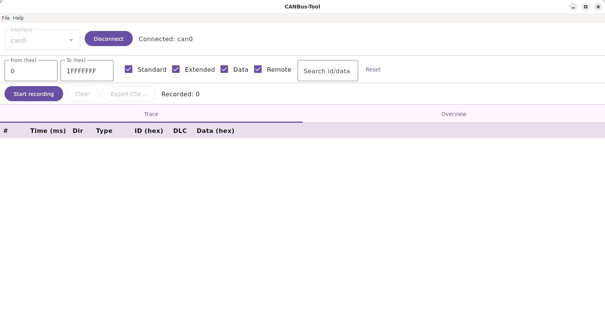
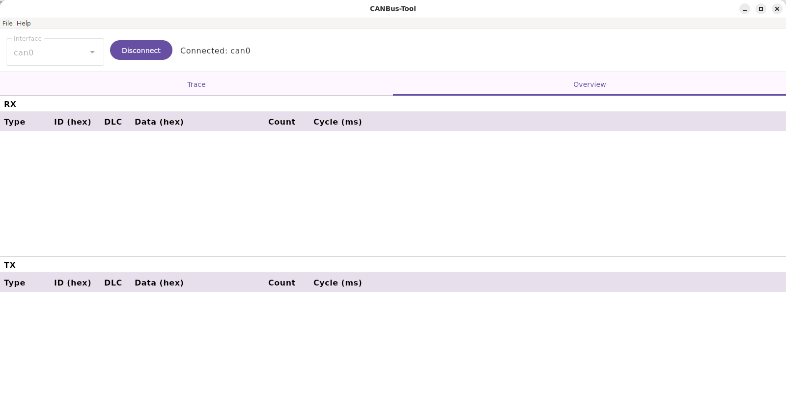

# CANBus-Tool

A Kotlin desktop application for Linux: live CAN message viewer, id/type filtering, recording
and CSV export for any CAN adapter the kernel exposes through SocketCAN (`can0`, `vcan0`, …).

## Screenshots

Trace view, with connection bar, filter panel and recording controls:



Overview view, with per-id RX/TX statistics:



## Modules

- `core` — platform-independent domain model: `CanMessage`, `CanConnection`, `MessageFilter`,
  `MessageStatsTable`, `RecordingSession`, `CsvExporter`. Pure Kotlin, built with the Kotlin
  Multiplatform plugin (currently targeting `jvm()` only).
- `socketcan` — a Linux SocketCAN backend: raw `AF_CAN` sockets via JNA calls into the OS's own
  libc (`socket`, `bind`, `ioctl`, `read`, `write`). No vendor library or driver is involved.
- `app` — the Compose Multiplatform Desktop UI: connection bar, filter panel, recording controls,
  and Trace/Overview views.

## System requirements to run CANBus-Tool

- **Java: nothing to install.** The packaged app bundles its own jlinked runtime.
- **A CAN interface that is up.** For a PEAK PCAN-USB (or any adapter with a mainline kernel
  driver) that is:

  ```
  sudo modprobe peak_usb
  sudo ip link set can0 up type can bitrate 500000
  ```

  For testing without hardware:

  ```
  sudo modprobe vcan
  sudo ip link add vcan0 type vcan
  sudo ip link set vcan0 up
  ```

  The bitrate is configured by the system, not by the app. The same instructions are in the app
  under Help → Set up CAN interface….

## Running

```
./gradlew run
```

## Building installers

```
./gradlew :app:packageDeb    # Linux .deb
./scripts/build-appimage.sh  # Linux AppImage (portable, no install needed)
./scripts/build-deb.sh       # Linux .deb (same as :app:packageDeb, with a compatible JDK picked)
./scripts/build-all.sh       # build + test everything, then the AppImage and the .deb
```

The AppImage isn't a Gradle task because Compose Multiplatform's packaging only wraps whatever
jpackage itself supports (deb/rpm/msi/dmg), and AppImage isn't one of those. The script instead
wraps `:app:createDistributable`'s output (which it runs first if needed) in the AppDir layout
`appimagetool` expects, fetching that tool on first run. Output lands at
`app/build/compose/binaries/main/appimage/CANBus-Tool-x86_64.AppImage`.

## Scope

Classic CAN (11/29-bit, up to 8 data bytes) only — no CAN FD. Filtering happens in software
(`MessageFilter`, applied to both the live view and recording).

## License

This software is licensed under the [MIT License](LICENSE).
